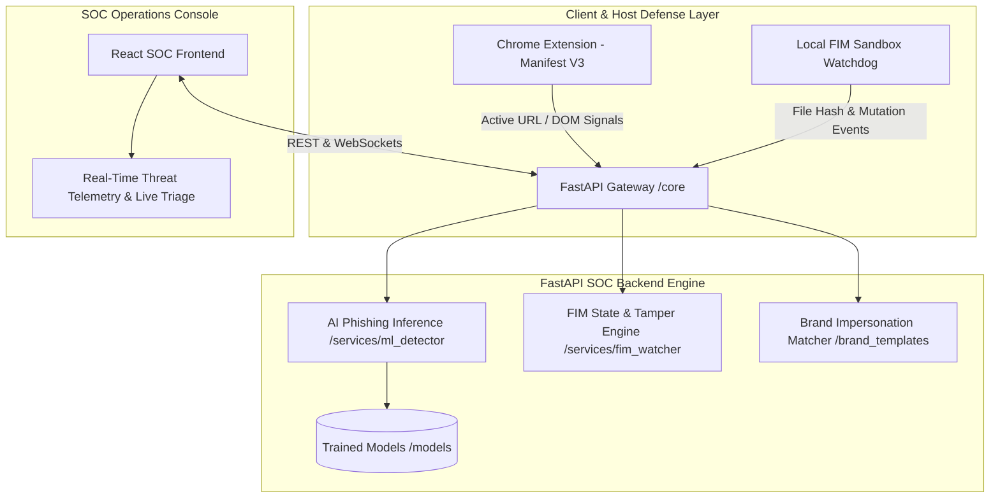

# 🛡️ Enterprise AI Phishing Detection & SOC Platform

[](https://fastapi.tiangolo.com)
[](https://react.dev)
[](https://developer.chrome.com/docs/extensions/develop)
[](https://github.com/gorakhargosh/watchdog)
[](https://opensource.org/licenses/MIT)

An enterprise-grade, multi-tiered cybersecurity platform combining **Machine Learning Phishing Detection**, a **Security Operations Center (SOC) Console**, a **Chrome Browser Defense Extension (Manifest V3)**, and a **Local File Integrity Monitoring (FIM)** sandbox.

---

## 📌 Architectural Overview

The platform bridges real-time client-side telemetry with deep server-side AI evaluation and host-level filesystem security:



---

## 📁 Production Directory Architecture

```text
ai-phishing-soc-platform/
├── .gitignore                     # Production-grade ignore rules (venv, .pkl, credentials, etc.)
├── README.md                      # Comprehensive system documentation & setup guide
├── init_project.sh                # Automated project setup script (Linux/macOS)
├── init_project.bat               # Automated project setup script (Windows)
│
├── backend/                       # FastAPI High-Performance Backend
│   ├── app/
│   │   ├── api/                   # REST API routes (v1 endpoints)
│   │   │   └── v1/
│   │   │       └── endpoints/     # Feature-specific route controllers
│   │   ├── core/                  # Security, configurations, and logging utilities
│   │   ├── models/                # Pydantic validation schemas and data models
│   │   ├── services/              # ML inference, FIM watcher, and brand verification
│   │   ├── utils/                 # Feature extraction, hashing, and token handling
│   │   └── main.py                # FastAPI application entrypoint
│   └── requirements.txt           # Python backend dependencies
│
├── data/                          # Data Storage Pipelines
│   ├── raw/                       # Raw datasets (PhishTank, OpenPhish, legitimate URLs)
│   └── processed/                 # Featurized datasets ready for model training
│
├── brand_templates/               # Normalized HTML/visual templates for impersonation detection
│
├── extension/                     # Chrome Browser Extension (Manifest V3)
│   ├── public/
│   │   ├── manifest.json          # Chrome Extension Manifest V3 configuration
│   │   └── icons/                 # Extension toolbar & alert icons
│   └── src/
│       ├── background/            # Background service worker (intercepts navigation)
│       ├── content/               # DOM scraper & in-page warning banner injector
│       └── popup/                 # Interactive user popup UI
│
├── frontend/                      # React SOC Analyst Dashboard
│   ├── public/                    # Static web assets
│   └── src/
│       ├── assets/                # Design assets and logos
│       ├── components/            # Reusable UI components (ThreatCards, GraphView)
│       ├── pages/                 # SOC views (Dashboard, IncidentDetails, FIMStream)
│       └── services/              # Axios/Fetch API integrations
│
└── fim_sandbox/                   # Monitored directory for File Integrity Monitoring demo
```

---

## 🚀 Quick Setup & Initialization

### Option A: Using the Automated Scripts

#### On Windows:
```cmd
init_project.bat
```

#### On Linux / macOS:
```bash
chmod +x init_project.sh
./init_project.sh
```

---

## 🛠️ Step-by-Step Module Setup

### 1. Backend Service (FastAPI)

```bash
# Navigate to backend and create virtual environment
cd backend
python -m venv venv

# Activate virtual environment
# Windows:
venv\Scripts\activate
# Linux/macOS:
source venv/bin/activate

# Install dependencies
pip install -r requirements.txt

# Launch FastAPI development server
uvicorn app.main:app --reload --host 0.0.0.0 --port 8000
```
API Documentation will be available at: `http://localhost:8000/docs`.

### 2. Chrome Extension (Manifest V3)

1. Open Google Chrome and navigate to `chrome://extensions/`.
2. Enable **Developer mode** (toggle in the top-right corner).
3. Click **Load unpacked**.
4. Select the `extension/` directory.

### 3. Frontend SOC Console (React)

```bash
cd frontend
npm install
npm run dev
```

---

## 🔗 Git Initial Commit & Remote Repository Connection

This repository is connected to:
**`https://github.com/OmMahajan101/ai-phishing-soc-platform.git`**

To stage your project, create the initial commit, and push to GitHub:

```bash
# 1. Initialize git (if not already done)
git init

# 2. Set default branch to main
git branch -M main

# 3. Connect remote repository
git remote add origin https://github.com/OmMahajan101/ai-phishing-soc-platform.git

# Verify remote
git remote -v

# 4. Stage all architectural files and configurations
git add .

# 5. Create initial production commit
git commit -m "feat: initialize enterprise AI Phishing Detection & SOC Platform architecture"

# 6. Push to GitHub main branch
git push -u origin main
```

---

## 🔒 Security & Data Hygiene
- **Never commit `.env` files**: All secrets, API keys, and model paths must remain local.
- **Model weights**: Models (`*.pkl`, `*.joblib`) are excluded from Git via `.gitignore`. Version them using DVC or remote cloud storage.
- **FIM Sandbox**: Dynamic files generated in `fim_sandbox/` during testing are automatically ignored by Git.
